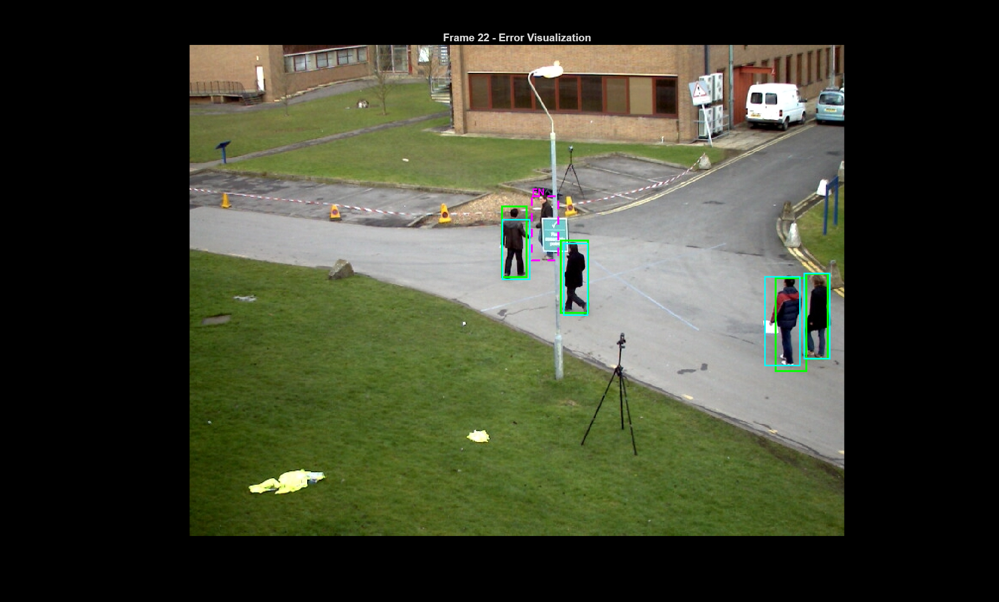
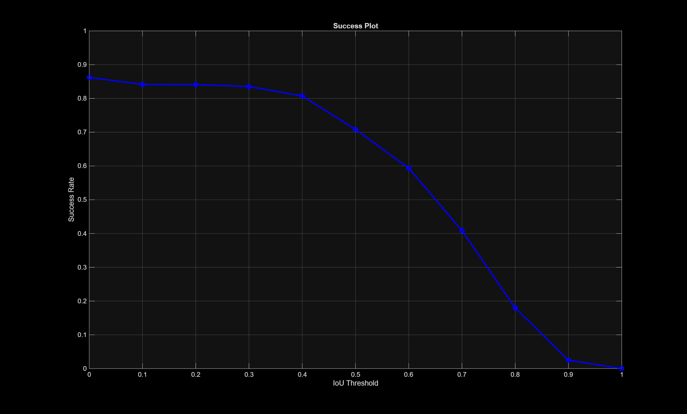
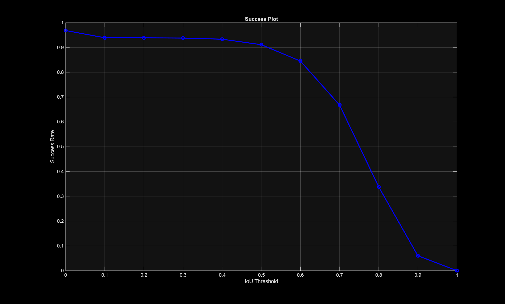
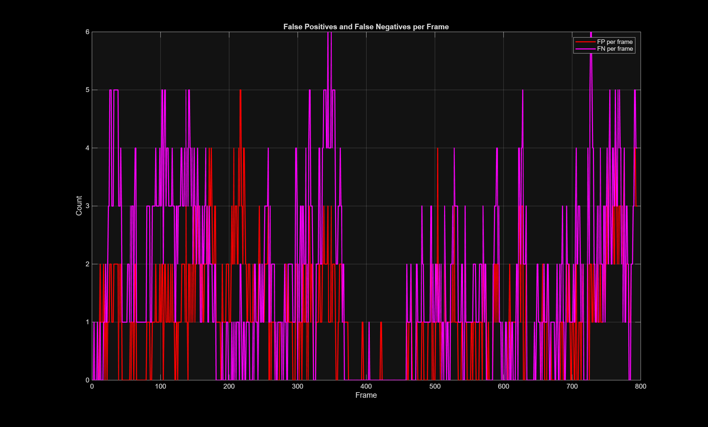

# Pedestrian Tracking on PETS 2009

Detection, tracking and trajectory analysis of pedestrians in the **PETS 2009
S2.L1** video sequence, written in MATLAB. The project builds a classic
computer-vision pipeline from scratch, measures it against the dataset's
ground truth, and compares it with a pretrained YOLO neural network.

Group 8 project for the CVI course at Instituto Superior Técnico (2025/26), by
Igor Martins ([@IgorMtecnico](https://github.com/IgorMtecnico)) and
Manuel Fernandes ([@M0nt31r1nh0](https://github.com/M0nt31r1nh0)).

## What it does

| Step | Script | Method |
|---|---|---|
| Detection and tracking | `GT.m` | Background subtraction, blob detection and appearance-based tracking, drawn frame by frame next to the ground truth |
| Trajectory heatmaps | `staticHeatmap.m`, `dynamicHeatmap.m` | Gaussian kernel density of where pedestrians walk, for the whole video or built up over time |
| Trajectory clustering | `EM.m` | Gaussian mixture models fitted with EM, with the number of clusters chosen by BIC |
| Evaluation | `performance.m` | IoU matching against the ground truth: success plot, precision, recall, F1, and false positives and negatives per frame |
| Neural-network baseline | `ai.py`, `NNperformance.m` | YOLO person detections on the same frames, evaluated the same way |

## Method

### Detection
- **Background model:** the per-pixel median of 40 frames spread evenly across
  the 795-frame video.
- **Foreground:** pixels where any colour channel differs from the background
  by more than 40.
- **Clean-up:** morphological closing and erosion, then connected components
  larger than 300 pixels become detections.

### Tracking
- Each detection gets a **32-bin hue histogram** of its foreground pixels as an
  appearance model.
- Tracks are matched to detections by **Bhattacharyya distance** between
  histograms, with a penalty when the detection is more than 50 pixels away.
  A match is accepted below a cost of 0.3.
- Matched tracks slowly update their appearance (95% old, 5% new), which
  keeps identities stable through small changes.
- A track that goes unmatched for more than 10 frames loses its trail, and it
  is retired once it has been missing for twice as long as it was seen.
- Unmatched detections start new tracks with new IDs.

Results are written to `results.txt` in the same format as the ground truth
(`frame id left top width height confidence -1 -1 -1`).

### Trajectory clustering
- Trajectories with at least 11 detections are smoothed, resampled to 11
  points, moved to start at the origin and scaled by their length, so the
  features describe **shape** rather than position.
- Gaussian mixtures with 1 to 20 components are fitted with EM (full
  covariance, 100 restarts), and BIC picks the best one: **2 clusters**.

| Cluster | Trajectories | Mean duration | Mean path length | Mean net displacement |
|---|---|---|---|---|
| 1 | 10 | 199 frames | 1060 px | 171 px |
| 2 | 14 | 140 frames | 776 px | 322 px |

Cluster 1 holds pedestrians who wander: they stay longer and walk further but
end up close to where they started. Cluster 2 holds people walking directly
from one place to another.

### Evaluation
Predictions are matched to ground-truth boxes per frame by greedy
intersection-over-union (IoU) matching. The success plot shows the share of
ground-truth pedestrians found at each IoU threshold from 0 to 1, and the other
statistics use a threshold of 0.5.

## Results

At an IoU threshold of 0.5, over 4,476 ground-truth boxes:

| Metric | Our pipeline | YOLO |
|---|---|---|
| True positives | 3,171 | 4,079 |
| False positives | 838 | 676 |
| False negatives | 1,305 | 397 |
| **Precision** | **0.791** | **0.858** |
| **Recall** | **0.708** | **0.911** |
| **F1-score** | **0.747** | **0.884** |

YOLO is better on every metric: about 8% higher precision, 29% higher recall
and 18% higher F1. The biggest gap is recall: our pipeline misses pedestrians
that background subtraction cannot see, such as the one hidden behind a sign in
the frame at the top of this page.

| Our pipeline | YOLO |
|---|---|
|  |  |

## Running it

### Requirements
- MATLAB with the Image Processing Toolbox and the Statistics and Machine
  Learning Toolbox.
- For the YOLO baseline: Python with the `ultralytics` package.
- The PETS 2009 S2.L1 frames (View 001), which are not in this repository.
  Place them so the frames are at
  `Crowd_PETS/S2/L1/Time_12-34/View_001/frame_0000.jpg` and onwards. The
  ground truth and camera calibration are already in `PETS-S2L1/`.

The scripts were written on Windows and some file paths use `\`. On macOS or
Linux, change them to `/`.

### Steps
1. **`GT.m`** runs detection and tracking, shows each frame and writes
   `results.txt`. The other MATLAB scripts read this file, so run it first.
2. **`staticHeatmap.m`** saves `static_heatmap.fig`; **`dynamicHeatmap.m`**
   shows the same heatmap growing over time.
3. **`EM.m`** clusters the trajectories and saves `BIC_CURVE.fig`,
   `CLUSTER_SHAPES.fig`, `CLUSTER_MEANS.fig`, `CONFIDENCE.fig` and
   `cluster_statistics.txt`.
4. **`performance.m`** evaluates `results.txt` and writes the plots and
   `evaluation_summary.txt` to `evaluation_output/`. This folder also has two
   example errors: `error_frame_0016.png` (a pedestrian missing from the
   ground truth, counted as a false positive) and `error_frame_0022.png` (a
   pedestrian hidden behind a sign, missed).
5. **`ai.py`** runs YOLO (`yolo26n.pt`) on every frame and writes
   `NNresults.txt`; **`NNperformance.m`** evaluates it into
   `NNevaluation_output/`. `ai.py` appends to `NNresults.txt`, so delete the
   old file before running it again.

The repository already contains the outputs of every step, so the results
above can be checked without running anything.
